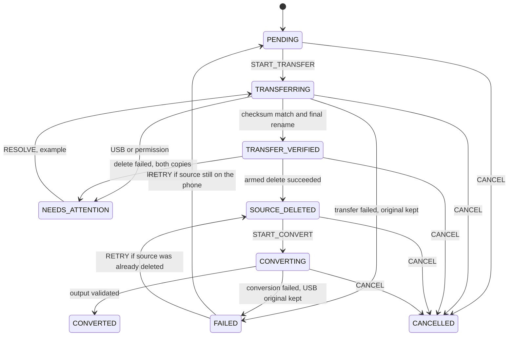

# Phase 1 — Architecture

Written before the library UI. The enforceable part lives in `core/` and is covered by `MoveStateMachineTest`.

## Conversion engine

**Decision: AndroidX Media3 Transformer (MediaCodec). Not FFmpeg.**

| | Media3 Transformer | FFmpegKit |
| --- | --- | --- |
| Status | Maintained AndroidX library. | Official project retired 6 January 2025. Maven artifacts removed 1 April 2025. |
| Forks | — | `FFmpegKitNext` is source-only. `dev.ffmpegkit-maintained` republishes binaries. Neither is the original supported line. |
| License | Apache 2.0. | libx264 builds are GPL. A GPL native library is the wrong default for this app. |
| Speed | Hardware H.264 encode on both phones (Adreno 618 / Exynos). One file at a time, which the spec requires. | Software encode is slower and hotter on these mid-range chips. Hardware encode through FFmpeg is still device-dependent. |
| APK size | A few megabytes. | A full build is tens of megabytes. |
| Inputs | What that phone's MediaCodec can decode: typically H.264/H.265 in MP4, and many MOV/MKV files. Not every odd codec. | Much wider. |

An input the phone cannot decode fails that file and leaves the USB original in place. It does not fall back to FFmpeg. Revisit only after real files on the real phone fail, and only with a non-GPL build. Nothing from either engine is linked in Phase 2.

Output, when conversion is built: MP4 container, H.264 video, AAC when the source has audio, short edge 480 or 720 only, aspect ratio preserved, no upscale, no silent stretch. `OutputResolution` has exactly `480p` and `720p`. `TransferMode` has exactly `MOVE`.

## Background strategy

**WorkManager plus a foreground service. Not either one alone.**

- WorkManager is the record of "this batch is unfinished" across process death and reboot.
- The worker promotes itself to a foreground service while bytes are moving, with a ongoing notification and a Cancel action.
- Service types, declared only when that work exists: `dataSync` for the USB copy, `mediaProcessing` (API 35) for the transcode.
- The delete dialog and every name-conflict question stay in an activity. The worker pauses that file, posts a notification, and does not guess.
- One UI battery optimization can defer or kill this. Background completion is not guaranteed. The app will say so when that work is built. Phase 2 has no service.

## Per-file state

`NEEDS_ATTENTION` stores `resumeState` and returns only there. It never jumps to `CONVERTED`.

### Idempotent rules

Implemented by `transition` in `core`. Calling a command that already happened returns `Applied(changed = false)` and does not repeat a destructive step.

- `START_TRANSFER` from `TRANSFERRING` is a resume. The caller must treat a temp file as incomplete and restream it. The source is not deleted.
- `MARK_TRANSFER_VERIFIED` and `MARK_CONVERTED` are no-ops if that state is already stored.
- Source delete runs only when `deleteShouldRun` is true: the arm command flipped `deleteDispatched` from false to true, the state is `TRANSFER_VERIFIED`, and `sourceDeleted` is false. A second arm does not flip it.
- `MARK_SOURCE_DELETED` is rejected if the delete was not armed, so a crash cannot record a delete that was not attempted.
- `RETRY` after a conversion failure returns to `SOURCE_DELETED`. It does not go back to `PENDING`, so the file is not transferred again and not deleted again.
- `RETRY` after a transfer failure returns to `PENDING` and clears the delete arm, because the source is still on the phone.
- `FAIL_SOURCE_DELETE` keeps `sourceDeleted` false, keeps both copies, and leaves the arm set so a restart cannot delete on its own. `RETRY_DELETE` is the only way to arm again, and it is rejected if the source was already deleted.
- Cancel does not delete the source, the USB original, or a finished MP4. It does not overwrite anything.

Reconciliation against real files is Phase 7. The machine does not assume a scheduled task succeeded.

## Room row

`MoveFileRecord` is the row. Phase 2 does not open a database yet; the type is the contract so the later Room entity cannot grow a copy mode or a third resolution.

| Column | Purpose |
| --- | --- |
| `id`, `batchId` | File and batch. |
| `sourceUri` | Content URI. Never reconstructed from a path guess. |
| `sourceParentDirectoryUri` | SAF parent, or null for a MediaStore-only file. |
| `sourceRelativePath` | `RELATIVE_PATH` such as `DCIM/Camera/`. |
| `originalFileName` | Name to preserve. Recorded before any byte moves. |
| `externalDestinationTreeUri` | USB tree. Not an output folder. |
| `destinationTempUri`, `destinationFileUri` | Temp name, then final name after the checksum matches. |
| `outputResolution` | `480p` or `720p` only. |
| `sourceChecksumSha256`, `destinationChecksumSha256`, `checksumMatch` | Verification. Null until compared. |
| `outputUri` | MP4 in the original directory. |
| `state`, `resumeState`, `errorMessage`, `attentionReason` | Machine. |
| `deleteDispatched` | Set immediately before the delete call. |
| `sourceDeletedAtEpochMs` | Set only after the delete API succeeds. |
| `createdAtEpochMs`, `updatedAtEpochMs` | Bookkeeping. |

Suggested Room name: `move_files`. Primary key `id`. Index `batchId`. No other table is required for Phase 2.
